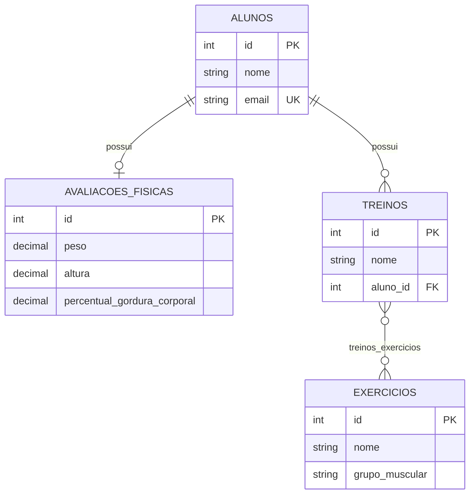

<h1 align="center">🏋️ Spring Boot Essentials</h1>

<p align="center">
  API REST para gestão de <b>alunos</b>, <b>avaliações físicas</b>, <b>treinos</b> e <b>exercícios</b>, construída com <b>Java 25</b> e <b>Spring Boot 4</b>.
</p>

<p align="center">
  
  
  
  
  
</p>

---

## 💡 Sobre o projeto

Uma academia precisa acompanhar a evolução dos seus alunos e organizar os treinos de cada um. Este projeto é a base de uma API que centraliza:

- o **cadastro de alunos**;
- o **registro das avaliações físicas** (peso, altura e percentual de gordura corporal);
- a **montagem de treinos**, que reúnem vários exercícios e pertencem a um aluno;
- o **catálogo de exercícios**, organizados por grupo muscular.

Ele foi pensado para praticar, na prática, os pilares de um back-end profissional com o ecossistema Spring: **modelagem de dados, persistência com JPA, organização em camadas e boas práticas de configuração e segurança**.

## ✨ Destaques técnicos

- **Stack atual:** Java 25 e Spring Boot 4.1.2, com Spring Web MVC e Spring Data JPA.
- **Modelagem relacional completa com JPA/Hibernate:** os três tipos de relacionamento em um só domínio:
    - **um-para-um:** aluno ↔ avaliação física
    - **um-para-muitos:** aluno → treinos
    - **muitos-para-muitos:** treinos ↔ exercícios, com tabela de junção (`treinos_exercicios`)
- **Arquitetura em camadas:** `controller` → `service` → `repository`, com injeção de dependência via construtor (`@RequiredArgsConstructor`).
- **Repositórios com Spring Data JPA:** interfaces que estendem `JpaRepository`, sem SQL manual para as operações básicas.
- **Credenciais fora do código:** usuário e senha do banco são lidos de **variáveis de ambiente**, evitando vazar segredos no repositório.
- **Banco criado automaticamente:** o schema `acad` é criado no primeiro start e as tabelas são geradas pelo Hibernate, o que facilita rodar o projeto em qualquer máquina.
- **Menos código repetitivo:** Lombok (`@Builder`, `@Getter`, `@Setter`, `@RequiredArgsConstructor`) deixa o código limpo.
- **Build padronizado:** Maven Wrapper incluso, sem precisar instalar o Maven para rodar.

## 🧩 Modelo de dados



| Entidade | Tabela | Descrição |
|---|---|---|
| `AlunosEntity` | `alunos` | Alunos cadastrados (e-mail único) |
| `AvaliacoesFisicasEntity` | avaliações físicas | Peso, altura e percentual de gordura corporal |
| `TreinoEntity` | `treinos` | Treino de um aluno, com vários exercícios |
| `ExerciciosEntity` | `exercicios` | Exercícios e seu grupo muscular |

## 🔌 Endpoints

| Método | Rota | Descrição |
|---|---|---|
| `GET` | `/e1/exercicios` | Lista todos os exercícios |

Exemplo:

```bash
curl http://localhost:8080/e1/exercicios
```

## 🗂️ Arquitetura

```
src/main/java/com/spring_boot_essentials
├── controller
│   └── ExerciciosController
├── service
│   └── ExerciciosService
├── database
│   ├── model
│   │   ├── AlunosEntity
│   │   ├── AvaliacoesFisicasEntity
│   │   ├── ExerciciosEntity
│   │   └── TreinoEntity
│   └── repository
│       ├── IAlunosRepository
│       ├── IAvaliacoesFisicasRepository
│       ├── IExerciciosRepository
│       └── ITreinosRepository
└── SpringBootEssentialsApplication

src/main/resources
└── application.yaml
```

## 🚀 Como rodar

**Você vai precisar de:** JDK 25 e MySQL ativo em `localhost:3306`.

**1. Clone o repositório**

```bash
git clone https://github.com/Simbiozze/spring-boot-essentials.git
cd spring-boot-essentials
```

**2. Defina as credenciais do banco**

```powershell
# Windows (PowerShell)
$env:DATABASE_USERNAME="seu_usuario"
$env:DATABASE_PASSWORD="sua_senha"
```

```bash
# Linux / macOS
export DATABASE_USERNAME=seu_usuario
export DATABASE_PASSWORD=sua_senha
```

**3. Suba a aplicação**

```powershell
.\mvnw.cmd spring-boot:run     # Windows
```

```bash
./mvnw spring-boot:run         # Linux / macOS
```

A API ficará disponível em **http://localhost:8080** 🎉

**4. Teste**

Como ainda não há endpoint de cadastro, a lista começa vazia. Para ver o `GET /e1/exercicios` funcionando, insira um exercício direto no MySQL:

```sql
USE acad;
INSERT INTO exercicios (nome, grupo_muscular) VALUES ('Supino reto', 'Peito');
```

## 🛣️ Roadmap

- [x] Setup do projeto com Spring Boot 4 e Java 25
- [x] Integração com MySQL via Spring Data JPA
- [x] Modelagem das entidades e dos relacionamentos (1:1, 1:N e N:N)
- [x] Repositórios com Spring Data JPA
- [x] Configuração segura via variáveis de ambiente
- [x] Listagem de exercícios (`GET /e1/exercicios`)
- [ ] CRUD completo de exercícios, alunos, treinos e avaliações físicas
- [ ] DTOs e validação de dados (Bean Validation)
- [ ] Tratamento global de exceções
- [ ] Documentação da API com OpenAPI/Swagger
- [ ] Testes automatizados (unitários e de integração)
- [ ] Containerização com Docker

## 📚 O que este projeto demonstra

- Capacidade de estruturar uma aplicação Spring Boot do zero
- Mapeamento objeto-relacional e modelagem de banco de dados com os principais tipos de relacionamento
- Separação de responsabilidades em camadas (controller, service e repository)
- Preocupação com segurança e portabilidade da configuração
- Organização de código pensada para crescer com o projeto

## 🎓 Aprendizado e créditos

Este projeto nasceu como parte dos meus estudos de Spring Boot. Apliquei no código os conceitos de **Spring Data JPA** aprendidos neste vídeo do YouTube:

▶️ [Curso Spring Boot: Dominando o Spring Data JPA - Parte 2](https://www.youtube.com/watch?v=XgfAabFGGj4&t=1581s) — canal **Souza Dev**

Parti do conteúdo do vídeo para construir a estrutura do projeto e, a partir dele, adaptei a modelagem para o meu próprio domínio (alunos, avaliações físicas, treinos e exercícios).

## 👨‍💻 Autor

**Miguel Scofield**
Desenvolvedor Java

[](https://github.com/Simbiozze)

---

<p align="center">⭐ Se o projeto te interessou, deixe uma estrela!</p>
